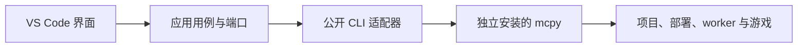

# mcpywrap — 游戏测试工作区

[](https://github.com/EaseCation/mcpywrap-vscode/actions/workflows/check.yml)
[](LICENSE)

在 VS Code 代码工作区中，通过 [mcpywrap](https://github.com/EaseCation/mcpywrap) 管理 Minecraft 中国版游戏测试、查看日志、执行 Python 和热更模块。

这是独立维护的开源扩展，目前处于 **0.1.0 开发预览**阶段。扩展单向调用 mcpy 的公开 CLI，mcpy 独立安装、独立升级，负责构建、部署和游戏生命周期。

## 功能与支持范围

| 能力 | 当前支持 |
| --- | --- |
| 测试工作区 | 项目、世界、会话与联调组树；支持多根工作区和显式子目录 |
| 启动与停止 | 默认世界、已有世界、新建世界、双客户端；停止单会话或整组 |
| 日志 | 游戏、引擎、worker 日志快照 |
| Python 执行 | 在选定会话的可用客户端/服务端执行编辑器选区，展示输出、值和异常 |
| 模块热更 | 热更已保存的 Python 文件，组成员通过组入口协调更新 |
| 环境诊断 | 只读诊断、CLI 路径配置及错误提示 |

当前面向 **Windows / Apple Silicon macOS 本机桌面**。Linux 参与构建和契约测试；Remote SSH、WSL 和虚拟工作区尚未接入游戏操作。扩展不携带 Python、游戏运行包或调试后端，游戏仍需要图形会话和 GPU。

自动热更、连续日志、完整配置编辑器、Test Explorer 和断点调试尚未实现，规划见 [交付路线](docs/roadmap.md)。真实游戏效果仍需按目标平台、引擎版本与端侧验证；自动化 CI 不启动真实游戏。

## 安装

需要 VS Code **1.95 或更新版本**，并独立安装 mcpywrap。当前 CLI 兼容基线为 **mcpy 0.5.2**。

推荐用 uv 安装 CLI：

```sh
uv tool install mcpywrap
mcpy --version
```

项目初始化、依赖准备与游戏运行环境配置见 [mcpywrap 文档](https://github.com/EaseCation/mcpywrap#readme)。

扩展暂未发布到 VS Code Marketplace，可通过以下方式获取 VSIX：

1. 在 [Actions](https://github.com/EaseCation/mcpywrap-vscode/actions/workflows/check.yml) 中打开最近一次成功运行，下载任意 `vsix-*` artifact 并解压；当前各平台生成相同类型的通用 VSIX。
2. 或按下方开发说明从源码构建。

在 VS Code 中选择“扩展 → … → 从 VSIX 安装”，加载生成的 `.vsix`。也可使用 CLI：

```sh
code --install-extension ./mcpywrap-vscode-0.1.0.vsix
```

## 开始测试

1. 打开已由 mcpy 初始化、含 `[tool.mcpywrap]` 声明的 `pyproject.toml` 项目。
2. 进入“游戏测试”侧栏，选择“运行测试”；尚无世界时选择命令“mcpy: 新建测试世界”。
3. 在世界节点启动指定存档；在会话或联调组上查看日志、停止测试。
4. 在 Python 编辑器选中代码，执行“mcpy: 在游戏中执行 Python 选区”，选择会话与 client/server。
5. 保存 Python 文件后，执行“mcpy: 热更当前 Python 模块”。

所有操作均可从命令面板访问。双客户端本地联调可能需要手动点击游戏局域网卡片加入；按 mcpy 返回的状态和提示操作。

游戏内代码遵循引擎内嵌 Python 与 ModSDK 的约束。执行选区使用临时调试作用域，模块热更更新模块，两者是不同操作。执行成功不代表玩法效果已验证；超时后应先查询会话和日志，避免重复执行有副作用代码。

关闭面板或编辑器会保留游戏。明确结束测试时使用扩展的停止命令或 mcpy CLI。

## 设置

| 设置 | 默认值 | 用途 |
| --- | --- | --- |
| `mcpy.executable` | `mcpy` | CLI 可执行文件名称或绝对路径，不填写 shell 命令 |
| `mcpy.projectRoots` | `[]` | 相对于当前工作区文件夹的项目目录；空数组自动识别根目录的 mcpy 声明 |
| `mcpy.queryTimeoutSeconds` | `30` | 只读查询等待上限 |
| `mcpy.operationTimeoutSeconds` | `600` | 启动、停止、执行和热更的等待上限 |

若 VS Code 没有继承终端 PATH，将 `mcpy.executable` 设置为本机可执行文件的绝对路径。一个工作区包含多个子目录项目时，例如：

```json
{
  "mcpy.projectRoots": ["addons/project-a", "addons/project-b"]
}
```

多根工作区可分别配置；扩展不会递归扫描依赖、缓存或整个磁盘。

## 架构



只有适配层了解命令参数和原始 JSON。扩展不导入 mcpy Python 源码、不读取内部运行目录、不复制部署锁或游戏后端；mcpy 无需依赖 VS Code。架构边界由自动检查维护。

设计按 **用户场景 → 交互 → 领域与用例 → 端口/适配器 → CLI 契约 → 分阶段验收** 展开：

- [产品场景与需求](docs/product.md)
- [交互流程与状态](docs/interaction.md)
- [架构与边界决策](docs/architecture.md)
- [CLI 契约与兼容策略](docs/cli-contract.md)
- [交付路线与验收](docs/roadmap.md)
- [竞品证据与取舍](docs/research.md)

## 开发与 CI

开发需要 Node.js **22 或更新版本**和 npm：

```sh
git clone https://github.com/EaseCation/mcpywrap-vscode.git
cd mcpywrap-vscode
npm ci
npm run check
npm run package
```

`npm run check` 执行严格类型检查、架构边界检查、单元/CLI 契约测试和打包构建。`npm run package` 先执行同样的检查，再生成 VSIX。开发本扩展无需检出 mcpy 源码，也不要求安装游戏。

在 VS Code 中打开本仓库，按 F5 启动 Extension Development Host。宿主集成测试使用独立 fake CLI 与临时工作区：

```sh
npm run test:extension
```

默认下载 stable VS Code；`VSCODE_TEST_VERSION` 可指定测试版本，`VSCODE_EXECUTABLE_PATH` 可使用本机已有的 Code 可执行文件。

[GitHub Actions](.github/workflows/check.yml) 在 push、pull request 和手动触发时运行：

- Ubuntu、Windows、macOS 上安装锁定依赖，执行检查、测试、构建并生成 VSIX；产物保留 14 天。
- macOS 上分别使用最低兼容版本 1.95.3 与 stable VS Code 进行隔离宿主测试。

CI 使用只读仓库权限，无需 mcpy、Python、游戏、账号或发布密钥。提交贡献与真机验收方式见 [CONTRIBUTING.md](CONTRIBUTING.md)。

## 反馈与许可

请通过 [Issues](https://github.com/EaseCation/mcpywrap-vscode/issues) 提交问题与建议，附扩展版本、mcpy 版本、系统、引擎版本、端侧和复现步骤。

本项目以 [MIT License](LICENSE) 开源。随 VSIX 打包的第三方依赖声明见 [THIRD_PARTY_NOTICES.md](THIRD_PARTY_NOTICES.md)。mcpywrap 与本扩展分别维护和发布。
