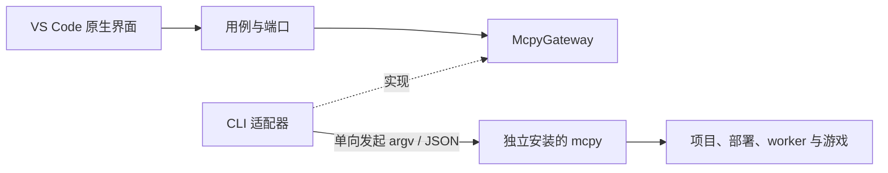

# 架构与边界决策

## 1. 系统边界

逻辑上的返回结果沿请求返回，不存在 mcpy 反向依赖插件、注册 VS Code 回调或专用 Host Bridge。两个项目没有源码、包或构建依赖。CLI 适配器是唯一理解公开命令与原始响应的地方。

## 2. 分层

| 层 | 职责 | 允许依赖 |
| --- | --- | --- |
| domain | Project、World、Session、Group、Capabilities、ExecutionResult、Target | 无导入 |
| application | inspect/start/stop/execute/reload/logs 用例，目标与能力检查，项目级变更互斥；Gateway/Transport/File 端口 | domain 与自身端口 |
| infrastructure/mcpy | 参数构建、原始 JSON 验证与归一化，Node 子进程、临时文件 | application/domain、Node 与本层 |
| infrastructure/workspace | 递归 TOML 标记发现、目录规范化与最近项目归属 | application/domain、Node、TOML parser |
| presentation | 项目树、目标 QuickPick、状态栏、进度与错误反馈 | application/domain、VS Code |
| extension.ts | 组合根：创建适配器，注入用例和界面，绑定生命周期 | 所有必要具体实现 |

application 不导入 vscode、child_process、Python 或 mcpy 源码。presentation 不拼 CLI 参数、不解释原始 JSON、不读运行目录。路径规范化在基础设施中完成；domain 的项目身份由调用端提供。

## 3. 领域对象与归属

Project：规范化 root、id 和 label；不包含依赖图或部署信息。

World：持久 ID、名称与状态；Session：运行 ID、模式、进程状态、worldReady、group/role；Group：组 ID、状态、成员和连接验证状态。Snapshot 是一次查询的归一化结果和局部问题列表。

Target 始终携带 Project 与 session/group ID；Python 操作额外携带 side。UI 选择不等于能力授权：执行前用 capabilities 查询实际可用端侧，操作时仍由 mcpy 校验最新状态。组成员的 reload/stop 使用组入口。

不缓存 token、端口、PID 或进程连接信息。游戏与 worker 身份校验、状态刷新、部署读者锁和权限均由 mcpy 持有。

## 4. 重要决策

**ADR-01：独立仓库与 CLI 优先。** 使用自己的 package.json、lockfile、CI 和 VSIX。拒绝 Python 源码导入、绑定 mcpy 版本的内部目录、游戏 hook 与私有控制协议。收益是发布与运行时解耦；代价是受公共 CLI 的可观察能力限制。

**ADR-02：原生工作台优先。** 初版采用 TreeView/QuickPick/Output，完整状态可测试且容易遵循 VS Code 交互。不将 Qt 配置页面逐一搬进 Webview。

**ADR-03：能力优于猜测。** 基线依据公开 CLI 0.5.2；关键字段校验，未知字段忽略。不使用版本号推断运行中 worker 的新能力。当前没有统一 CLI 协议版本，不能伪造完整协商；不兼容时报告实际命令和错误，独立动作降级。

**ADR-04：未知结果保留。** Transport 区分 spawn 失败、明确操作失败、查询失败和已提交变更结果未知；无自动重试。项目级互斥只限制本窗口的变更，跨窗口正确性依赖 mcpy 原有锁，不实现第二套锁。

**ADR-05：公开增量日志。** 通过通用 logs --follow JSONL 订阅增量日志；保留有限快照查询。旧 CLI 报缺少能力，不读取内部日志路径，也不以文本去重伪造连续流。

**ADR-06：断点后置为通用端点客户端。** 未来插件请求 mcpy 提供通用 debug start/inspect/attach metadata，并连接公开 DAP endpoint。后端、解释器、暂停线程、来源/行号映射和运行包能力由 mcpy 或独立通用调试后端负责。DAP 自身的请求/事件属于调试协议，不构成工具对插件的产品依赖。端点尚未公开前，不登记可运行的假 debugger。

**ADR-07：桌面与执行位置明确。** 初版工作区扩展运行在本机 Windows/macOS 桌面；Remote SSH/WSL 与虚拟工作区明确拒绝游戏操作。未来远程通过通用 CLI --remote 能力扩展，不能默认回退本机或假设支持本地世界部署。

## 5. 演进边界

若 CLI 启动开销成为实测瓶颈，先评估 mcpy 提供通用事件流或可复用 stdio API。新 API 必须独立于编辑器、CLI 用户同样受益、有版本和错误契约，CLI 适配器才替换传输实现。不得为 VS Code 把构建或游戏状态反向写回插件。

自动热更优先作为公开 watch 命令的可管理任务，停止 watcher 与停止游戏分开。项目脚本、依赖编辑、世界参数表单只调用公开能力；避免在插件实现第二套准备计划或 TOML 业务编辑规则。

## 6. 可执行边界验证

`npm run check:architecture` 检查导入方向与私有运行目录耦合；contract tests 使用独立 fake CLI，覆盖 shell 元字符、Unicode、失败和超时。宿主 smoke tests 验证真实 VS Code 激活与命令流程；测试不检出 mcpy 仓库、不安装 Python、不启动游戏。

## 7. 自动发现与编辑器上下文

VS Code 文件搜索提供工作区内 `**/pyproject.toml` 候选，排除环境、构建输出和依赖缓存；FilesystemDiscovery 只读取候选声明，校验工作区边界、TOML 表及规范路径。有效 tool.mcpywrap 表才标记项目，父项目与嵌套项目均保留，文件使用最近项目根目录。每工作区最多 2000 个声明，达到上限报告问题。

候选搜索与 TOML 解析只在首次激活、显式刷新、工作区变化或声明 create/change/delete、保存及目录创建/删除后发生；声明事件防抖 250 ms，忽略缓存目录。识别结果和文件归属缓存于内存，切换文件不扫描、不启动 mcpy。标题菜单使用已打开文件的 resourcePath 集合匹配，点击按资源 URI 路由，支持拆分编辑器。首次激活只识别项目；运行时操作只查询所选项目，手动刷新全列表的查询并发最多 3 个项目。

## 8. 原生日志与片段编辑器

LogFollower 端口保持不变，仍由一个长期通用 CLI JSONL 流提供数据，presentation 不读取日志路径。应用层 LogHistory/协议过滤器维护有界共享历史和逐流半行缓存，来源/详情切换只回放内存，不重开跟随进程。

RuntimeConsole 使用两个原生 OutputChannel，分别承载引擎（engine/worker/系统消息）与脚本系统（game/Python 结果）。通过独立的 mcpy-log 语言与 TextMate grammar 实现按规则着色。palette 只为本语言的专用 scope 提供默认值，允许用户和主题覆盖；不调用 settings.update。搜索、复制、清空、自动滚动使用原生输出器。

Python 片段在 ExtensionContext.storageUri（无工作区时回退 globalStorageUri）的 snippets/ 中创建命名 `.py` 文件，使用原生 Python 编辑器、QuickPick、CodeLens、编辑器标题命令、状态栏与快捷键。片段目录由组合根注入；创建时写入初始内容，编辑和执行不自动保存。绑定按文档 URI 在窗口内存中保留，关闭再打开仍可使用，窗口重载不恢复执行目标。CodeLens 只做 URI 内存查表，不扫描或调用 CLI。执行捕获 TextDocument.getText 的内存快照，复用 Workbench.execute、能力检查与一次性 UTF-8 临时文件，完成或失败后清理该临时文件；不创建 HTML、Webview、伪终端或自定义输入控件。关闭草稿保留已连接的游戏与日志。
