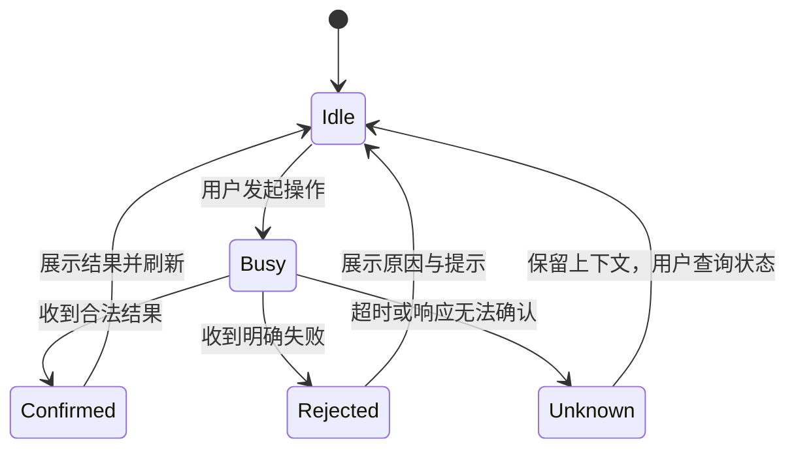

# 交互、信息结构与状态

## 1. 工作台布局

```text
游戏测试
  项目 A                         [运行] [刷新]
    世界：保留进度的日常世界        [运行]
    联调组：等待客机加入            [日志] [停止整组]
      host · running
      guest · waiting_for_join
    会话：单人世界 · running        [日志] [停止]
  项目 B
    查询失败：保留上次结果，需刷新

状态栏：mcpy · 项目 A · host/会话 · client
输出：每次执行的目标、结果与错误；日志接入底部工作台及独立 Output 通道
```

世界是持久存档；会话是一次运行；组是联调成员集合。UI 保持三种概念，不能以终端或端口充当会话身份。单独会话与组成员避免重复展示。

## 2. 首次进入与空状态

无工作区：引导打开项目。未发现项目：说明通过 `pyproject.toml` 的 `[tool.mcpywrap]` 自动识别；提供配置 CLI 和刷新。项目无世界、无会话：保留项目节点，提供新建测试世界。工具不存在：报告配置的可执行文件与设置入口，不自动安装软件。工程未准备：显示 mcpy 的诊断与 hint，依赖操作继续在 CLI 中进行。

通过 VS Code 文件搜索自动发现工作区及其子目录中声明了 `[tool.mcpywrap]` 的 `pyproject.toml`，无需配置项目目录；构建产物、环境和依赖缓存不参与发现。文件归属使用最近的已识别项目根目录；普通 Python 工程不会成为 mcpy 项目。新增、修改和删除声明会触发自动刷新。

项目内任意本地文件打开后，编辑器右上角显示“运行测试”和“游戏测试”更多菜单，后者提供新建世界、双客户端、日志、停止和诊断。Python 文件额外显示热更；执行选区在 Python 选区存在时可用。切换到非项目文件立即隐藏入口；拆分编辑器点击命令时以被点击标签的 URI 确定项目，不以另一个编辑器的活动目标替代。切换文件仅更新项目上下文，不执行游戏命令。

## 3. 启动与运行

选择项目/世界 → 显示操作进度 → 执行 mcpy → 显示 session/group 与实际返回状态 → 刷新树。无配置时不接管 F5/Ctrl+F5，避免覆盖用户 Python 调试行为。

“运行测试”按 mcpy 默认规则选择世界；“新建测试世界”才传 new；从世界节点运行传完整世界 ID。双客户端为独立命令；等待加入提示保留原文。

already_running/source_matches/hint 需要可见：显示“复用现有进程”，不能用“新代码已应用”。运行状态来自 mcpy；显示 running 时仍保留“进程状态，不代表玩法验证”的说明。

停止组成员时将目标提升为其所在组，并在确认文案显示“停止整个联调组”和成员范围；不会隐式单独停止主机。停止查询与日志没有额外确认；普通独立会话停止直接使用用户所选目标。

## 4. Python 执行与热更

执行选区：校验 Python 文档与非空选区 → 根据文件所属项目过滤会话 → 选择运行会话 → 查询能力 → 选择端侧 → 显示目标 → 临时 UTF-8 文件 → CLI → 输出 stdout/stderr/value/error/state。

用户必须明确选择会话；上次选择可在同一项目内优先显示，但不能跨项目复用。客户端/服务端不根据目录名推断。执行不会自动保存或执行整份文件。

热更当前模块：要求 file URI 和已保存文件 → 选择当前项目中的会话与可重载端侧 → 若属于组，查询组协调能力并调用组热更 → 显示每个返回成员的实际结果。第一次版本拒绝替用户保存未保存文件，提示先保存，避免不知情修改源码。

临时选区脚本仅表示一次运行时执行，不是模块替换。热更可能留下旧对象和回调，不承诺状态迁移。未知/部分成功保留详细结果，不重复注入。

## 5. 状态与失败模型



进程未能 spawn 是“未提交”；变更命令已启动后超时、进程断开或结果无法解析是“结果未知”。终止等待只终止 CLI 等待进程，不代表后台 worker 或游戏停止。启动结果丢失后用同项目 status --list 找回；执行结果未知保留 request_id 并按 CLI 能力查询。无 request_id 时显示日志和目标，不捏造请求身份。

查询失败与“没有会话”不同：保留上次 snapshot，显示过期和错误；部分查询失败保留仍有效的数据。快照查询仍明确标记采样时间；连续日志独立通过通用 JSONL 流接入，不通过尾部文本去重伪造实时流。

## 6. 键盘、可访问性与退出

所有操作可从命令面板访问；图标配备文字、QuickPick description 和 tooltip；颜色仅辅助表达状态。进度不会抢走编辑焦点，代码输出在用户明确执行后打开。

面板关闭、扩展卸载和窗口重载只释放 UI 资源，不停止游戏。当前无后台运行状态轮询；首次激活只识别项目，用户显式刷新或操作所选项目时查询状态，避免不必要的进程与状态噪声。未来事件流或自动刷新需增加可见的订阅生命周期与退避。

性能约束：声明发现结果缓存，文件切换只更新内存中的项目上下文；声明 watcher 防抖 250 ms，忽略产物/缓存。手动刷新全列表的查询并发最多 3 个项目。编辑器快捷入口按资源路径集合匹配，不随另一个分栏的活动项目串台。

## 7. 启动后的运行工作台

启动或复用测试成功后自动打开底部“游戏测试 / 日志与 Python”。同一次启动绑定的 session/group 立即订阅引擎、脚本和 worker 增量日志；同时提供 VS Code Output 来源通道。面板包含会话选择、client/server 选择、多行 Python 输入、执行按钮与 Ctrl/Cmd+Enter；不要求在源码中创建临时文件或手动选择编辑器选区。

会话选择显示项目、角色和完整 ID 的缩写。执行时捕获目标、端侧与代码，结果按原目标呈现，即使执行期间用户切换会话也不会串台。输出显示 stdout/stderr、value、error、state 和 request_id；unknown 不自动重试。能力未就绪时可显式刷新，网络客机不开放 server。

日志订阅使用一个长期公开 CLI 流，按来源和成员标记；不轮询快照、不按文本去重。重复文本和 UTF-8 半行保留。面板和宿主记录都有容量上限，批量投递到 Webview。隐藏面板不丢订阅；“断开日志”或扩展退出只结束跟随进程，游戏仍由 mcpy 管理。会话自然结束时排空日志并标记结束。重新连接保留明确的历史分界，不能冒称无缝恢复。
